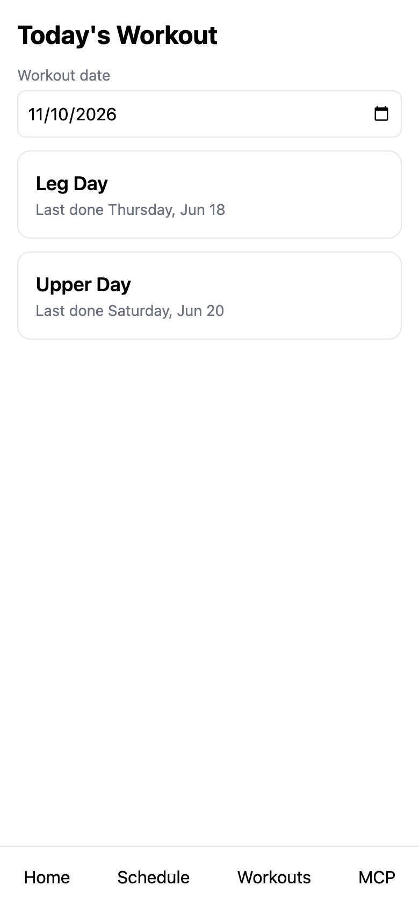
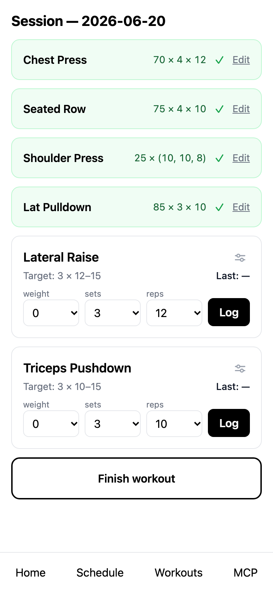
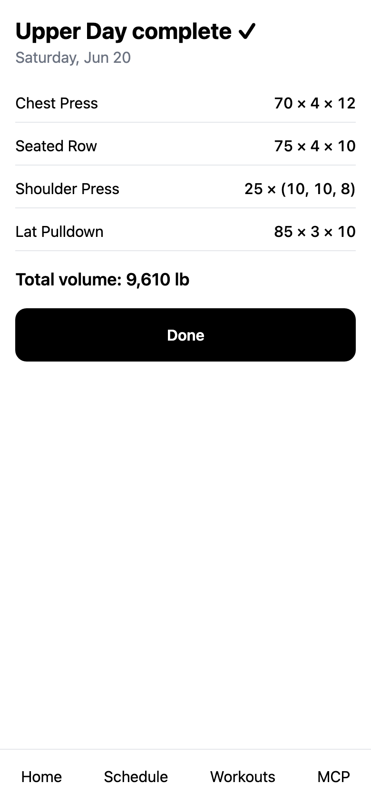
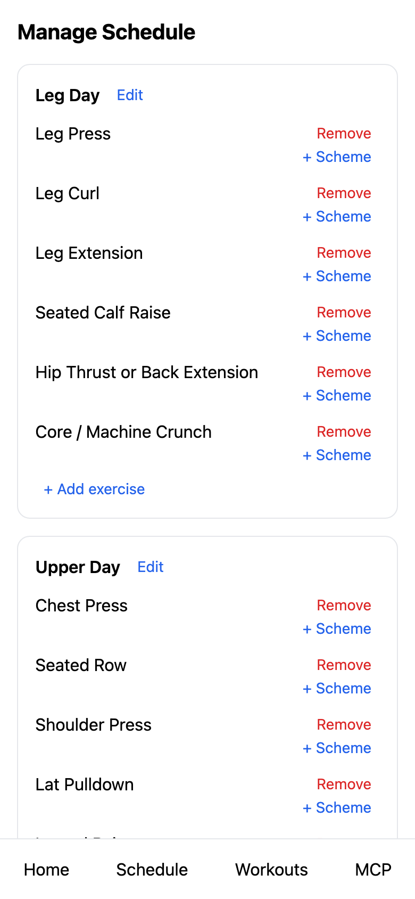
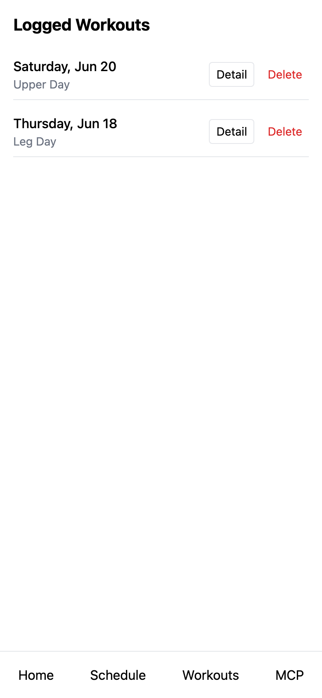
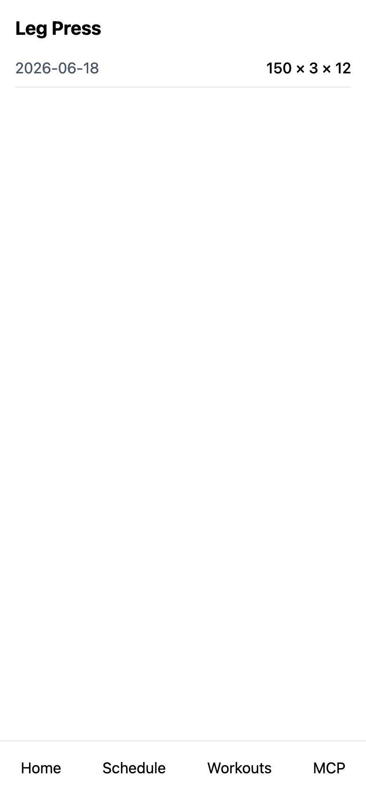
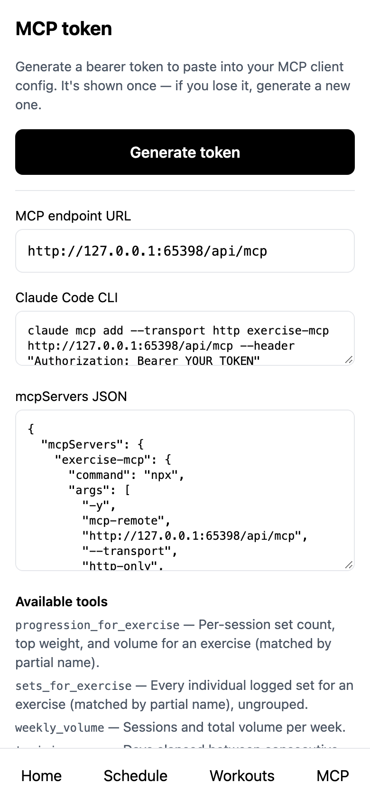

# exercise

A mobile-first web app (PWA) for logging weightlifting workouts. You build
programs out of day templates, give each exercise on a day its own
progressive set scheme, then log sessions set by set. The app shows your
history per exercise and a summary after each session. It also runs an MCP
server with 32 tools, so an AI client such as Claude can read your training
data and rides and edit your plan.



## Features

- Programs made of ordered day templates; each day holds an ordered list of
  exercises.
- A per-day set scheme for each exercise (target weight and reps per set),
  with the history of every scheme change kept.
- Session logging: pick a day, log weight and reps for each set, see what you
  did last time.
- Screens: Home (`/`), ManageDays (`/days`), Session (`/session/:id`),
  Summary (`/session/:id/summary`), LoggedWorkouts (`/workouts`), History
  (`/history/:exerciseId`) and MCPLogin (`/mcp-login`).
- An MCP server for AI clients, with per-user bearer tokens.
- Built with React 19, Vite 8, TypeScript, Tailwind CSS, React Router 7 and
  Vitest.

### Screens

Logging a session, the summary after it, managing the schedule, the list of
logged workouts, and one exercise's history:

<p>





</p>

## Run it in two minutes

You need Node.js (CI uses Node 24) and npm. Nothing to sign up for.

```bash
npm install
npm run dev
```

Open the URL Vite prints (http://localhost:5173 by default).

The data backend is chosen at build time by `VITE_DATA_BACKEND`. When it is
unset, as it is here, the app uses an in-memory mock backend seeded with
starter exercises and day templates. There is no account and no sign-in.
The data lives in the page, so a reload starts over. The other values are `supabase` and `starkeep`; see
[Deploy it](#deploy-it).

## Talk to it from Claude

The app includes an MCP ([Model Context Protocol](https://modelcontextprotocol.io))
server. Once it is connected, you can ask Claude things like "how has my leg
press progressed?" or "add a fourth set to squats on day A", and Claude calls
the app's tools with your data.

MCP needs a deployed backend (Vercel + Supabase or Starkeep); the mock backend
from `npm run dev` has no MCP server. In the deployed app, open the **MCP**
screen (`/mcp-login`) and create a token. Each token belongs to one user and
can be revoked from the same screen. The screen shows your endpoint URL and
this command for Claude Code, filled in:

```bash
claude mcp add --transport http exercise-mcp <endpoint> --header "Authorization: Bearer <token>"
```

On Vercel the endpoint is `https://<your-domain>/api/mcp`. Custom connectors
on claude.ai take the same `Authorization` header.



The 32 tools (the authoritative list is
[`src/mcp/__fixtures__/tools-list.main.json`](src/mcp/__fixtures__/tools-list.main.json)):

| Kind | Tools |
| --- | --- |
| Read (9) | `progression_for_exercise`, `sets_for_exercise`, `weekly_volume`, `training_gaps`, `get_day_templates`, `get_workout_history`, `scheme_history_for_day_exercise`, `adherence_for_day`, `list_exercises` |
| Read: rides (7) | `list_activities`, `get_activity`, `activity_stats`, `training_load`, `power_curve`, `weight_history`, `sync_status` |
| Write: day templates (7) | `create_day_template`, `rename_day_template`, `delete_day_template`, `add_exercise_to_day`, `remove_exercise_from_day`, `reorder_day_exercises`, `set_day_exercise_scheme` |
| Write: exercises (3) | `create_exercise`, `update_exercise`, `delete_exercise` |
| Write: programs (6) | `create_program`, `rename_program`, `delete_program`, `add_day_to_program`, `remove_day_from_program`, `reorder_program_days` |

## Deploy it

There are three ways to run the app for real. Pick one.

- **Vercel + Supabase.** This is the owner's deployment: Vercel runs
  `npm run build` (per `vercel.json`) with `VITE_DATA_BACKEND=supabase`, and
  CI applies database migrations from `main`. Full steps are in
  [docs/deploying.md](docs/deploying.md).
- **Starkeep local.** Starkeep's admin-web starts the app on your machine
  with `npm run starkeep:serve -- -p <port>`, the `localRun` command in
  `starkeep.manifest.json`; see [starkeep/README.md](starkeep/README.md).
- **Starkeep cloud.** The Starkeep installer runs `bundle` to build
  `dist.zip` and deploys it as a Lambda behind the Starkeep API Gateway under
  `/apps/exercise`; see [starkeep/README.md](starkeep/README.md).

## Repo layout

| Path | What it holds |
| --- | --- |
| `src/` | The single-page app: screens, data layers (mock, Supabase, Starkeep), the shared MCP tool definitions in `src/mcp/`, and the analysis logic in `src/analysis/`. |
| `api/` | Vercel serverless functions: the MCP server (`api/mcp.ts`) and the token endpoints. |
| `starkeep/` | The Starkeep server, its MCP server (`starkeep/mcp.ts`), the Lambda handler and the bundle script. |
| `supabase/` | SQL migrations, applied to production from `main` by CI. |
| `scripts/` | The migration version checker CI runs, and a Garmin weigh-in export. |
| `docs/` | [Deployment](docs/deploying.md), design history (`docs/superpowers/`) and lead-session docs for AI agents (`docs/agents/`). |
| `CLAUDE.md`, `AGENTS.md`, `.claude/` | Instructions for AI coding agents working on this repo. |
| `LICENSE` | MIT. |

The analysis behind the read tools (progression, volume, gaps, adherence) is
plain TypeScript in `src/analysis/`. It replaced SQL functions, and its tests
check it against the semantics of that SQL. The ride tools share one
implementation in `src/analysis/rides/`, over the ride maths in `src/metrics/`.

## Development

```bash
npm run typecheck       # tsc for the app, api/ and starkeep/
npm test                # vitest run
npm run test:coverage   # vitest with v8 coverage; CI fails under 80% lines or 80% functions
npm run build           # tsc -b && vite build
npm run screenshots     # the seven README screenshots with Playwright; one-time setup: npx playwright install chromium
```

CI (`.github/workflows/ci.yml`) runs `npm run typecheck` and
`npm run test:coverage` on every pull request and push to `main`.

`CLAUDE.md` and `AGENTS.md` are the instructions AI coding agents follow in
this repo, and `.claude/` holds their settings and skills.

[`docs/superpowers/`](docs/superpowers/) holds the design history: specs and
plans written since June 2026. Read it for the reasoning behind a choice, not
as a description of the current code. Older documents can describe states
that have since changed; for example, the July plan says the Supabase project
ref is hardcoded in `query.sh`, which is no longer true.

## License

MIT; see [LICENSE](LICENSE).
